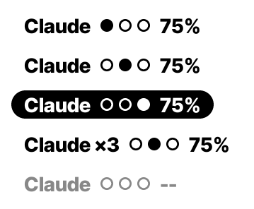
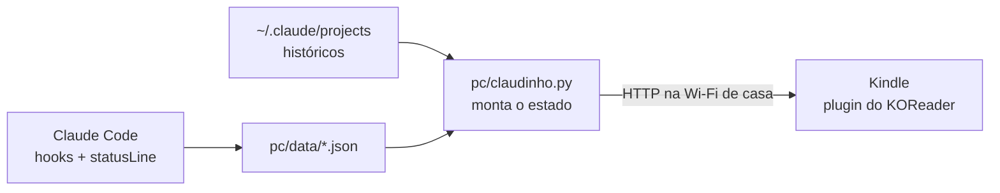

# Claudinho no Kindle 2.0

O status do Claude Code no seu Kindle, como um plugin do **KOReader**: um painel em tela cheia quando você quer acompanhar, e uma linha discreta no topo da página enquanto você lê.


Inspirado no [kindle-claude](https://github.com/guithepc/kindle-claude), de guithepc: o design do painel, o Claudinho chef em pixel art, os hooks e a contagem de tokens vêm de lá. O que muda:

| | kindle-claude | 2.0 |
|---|---|---|
| No Kindle | scriptlet que desenha por cima de tudo | plugin do KOReader |
| Voltar aos livros | só reiniciando ou pela rota `/parar` | um toque na tela |
| Enquanto lê | nada | linha no topo da página: estado e % da sessão |
| Quem desenha | o PC (Pillow) envia imagens | o Kindle desenha a partir de um JSON de ~400 bytes |
| PC | macOS/Linux + Pillow | macOS, Linux ou Windows, só Python |

## Enquanto você lê

Uma linha pequena, centralizada no topo da página, mostra o que o Claude está fazendo e quanto da sessão de 5 horas já foi usado.




- **As três bolinhas**: a cheia diz o estado. A primeira é parado (sem tarefa, ou terminou e espera o seu próximo pedido), a segunda é trabalhando, a terceira é pedindo sua permissão.
- **Pedindo permissão**, a linha fica branca numa pílula preta, para chamar a atenção de longe sem animação.
- **O %** é o quanto da sessão de 5 h já foi usado. Num plano sem limite de uso, ou antes da primeira resposta numa janela nova, aparece 0%.
- **Com vários agentes** trabalhando ou pedindo permissão, aparece quantos: "Claude ×3". As bolinhas mostram o mais urgente.
- **Sem sinal do PC**, a linha fica cinza, sem bolinha cheia e com "--" no lugar do %.

A linha só é redesenhada quando muda, e a atualização pega só a faixa dela. Ela não pisca a cada virada de página, porque faz parte do desenho do próprio leitor.

Para a linha não cobrir o texto, o plugin aumenta só a margem de cima, o bastante para ela caber (de 15 para 28, com as margens padrão). O KOReader só tem as quatro margens da página, então não dá para o texto contornar só a linha. A sua margem continua gravada no livro e volta quando você desliga a linha em **Claudinho → Mostrar o status no topo da página**.

## O painel

**Claudinho → Abrir o painel**, no menu do KOReader (ou um gesto que você escolher). Um toque em qualquer lugar volta para o livro ou a biblioteca.

| Trabalhando | Pedindo aprovação | Pronto | Descansando |
|:-:|:-:|:-:|:-:|
|  |  |  |  |

O painel mostra:

- o que o Claude está fazendo agora e as últimas ferramentas;
- o % usado da sessão de 5 h e da semana, com a hora em que cada um zera;
- os tokens de hoje, da última hora e a média diária;
- o Claudinho chef animado, mas só no retângulo dele, para o resto da tela e-ink ficar parado.

Com vários agentes rodando, aparece o mais urgente: pedindo permissão > trabalhando > terminou > descansando, e o topo do painel mostra quantos estão trabalhando ("3 AGENTES").

### Português ou inglês

As telas no Kindle (painel, linha do topo e menu) existem em português (Brasil) e em inglês. A escolha é feita no próprio Kindle, em **Claudinho → Idioma** (*Language*), e vale na hora, sem rodar o setup nem copiar o plugin de novo. Sem escolha, segue o idioma do KOReader: português se ele estiver em português, inglês nos outros.

O assistente e o agente no computador falam sempre em inglês.

## Como funciona



1. Os **hooks** do Claude Code gravam o que cada sessão está fazendo; a **statusLine** guarda o % de uso.
2. O **agente** (`pc/claudinho.py`) junta tudo num JSON pequeno, o "estado".
3. O agente responde na rede de casa. Kindle e PC precisam estar na mesma Wi-Fi.
4. O **plugin** busca o estado a cada 60 s lendo (30 s com o painel aberto), num subprocesso para a leitura nunca travar. Quando nada mudou, o agente responde só "304, igual", sem conteúdo.

Detalhes em [docs/como-funciona.md](docs/como-funciona.md).

## Instalação

### O que você precisa

- **Kindle com jailbreak e KOReader.** Guias: [jailbreak](https://kindlemodding.org/jailbreaking/) e [KOReader](https://kindlemodding.org/jailbreaking/whats-next/getting-koreader/) no Kindle Modding. Feito para o Kindle básico de 10ª geração (600×800), mas o painel se ajusta a outras telas.
- **Computador** com Python 3.9+ e o Claude Code. Não precisa instalar nenhuma biblioteca.
- Kindle e computador **na mesma rede Wi-Fi**.

### 1. No computador

```sh
git clone https://github.com/phnrezende/kindle-claude2.0.git
cd kindle-claude2.0
python3 pc/setup.py
```

O assistente:

1. liga os hooks e a statusLine no `~/.claude/settings.json` (ou no da pasta de `CLAUDE_CONFIG_DIR`, se você usa essa variável), com backup, e mantendo a sua statusLine antiga;
2. pergunta o IP do computador e a porta (o padrão serve quase sempre) e gera um token;
3. grava `pc/config.json` e `kindle/claudinho.koplugin/config.lua`.

No Windows, o Claude Code roda os comandos no Git Bash quando ele está instalado, e no PowerShell quando não está. O setup confere qual é o seu caso e grava os comandos no formato certo. Se você instalar o Git Bash depois, rode o setup de novo.

Depois, deixe o agente rodando:

```sh
python3 pc/claudinho.py
```

Para ele subir sozinho quando você entra no computador, veja [Deixar o agente sempre ligado](docs/problemas.md#deixar-o-agente-sempre-ligado).

Reinicie as sessões do Claude Code que já estavam abertas, para elas passarem a mandar eventos.

Mudou o IP ou a porta? `python3 pc/setup.py connection` e copie o plugin de novo. Para trocar o token, `python3 pc/setup.py connection --new-token`.

### 2. No Kindle

1. Ligue o Kindle no cabo.
2. Copie a pasta `kindle/claudinho.koplugin` (já com o `config.lua` que o setup gerou) para `koreader/plugins/`.
3. Ejete e abra o KOReader. O menu **Claudinho (Claude Code)** aparece em **Ferramentas**.
4. Para conferir: **Claudinho → Conexão → Testar a conexão agora**.

Também dá para configurar tudo pelo menu, sem o `config.lua`: **Conexão → Endereço** e **Token**.

### Testar sem o Kindle

O KOReader roda no computador (ou numa máquina virtual Linux), e o agente tem dados de demonstração:

```sh
python3 pc/claudinho.py --demo chamando
```

Guia completo em [docs/emulador.md](docs/emulador.md).

## No dia a dia

| Quero… | Como |
|---|---|
| Ver o painel | Menu → Ferramentas → Claudinho → Abrir o painel |
| Voltar aos livros | tocar em qualquer lugar do painel |
| Abrir com um gesto | Configurações → Toques e gestos → Gerenciador de gestos → escolha um gesto → Geral → **Claudinho: abrir o painel** |
| Ligar/desligar a linha do topo | Claudinho → Mostrar o status no topo da página, ou o gesto **Claudinho: ligar/desligar o status no topo** |
| Painel com o logo do Kindle do outro lado | Claudinho → Painel → Logo do Kindle à direita |
| Telas em inglês (ou em português) | Claudinho → Idioma |

Com o painel aberto, o Kindle não dorme (dá para desligar isso no menu Painel). Deixe-o no carregador se for usar como painel de mesa.

## Configurações

| Onde | Opção | Padrão |
|---|---|---|
| Mostrar o status no topo da página | a linha "Claude ●○○ 75%", com o espaço dela reservado na margem de cima | ligado |
| Painel | logo do Kindle à esquerda/direita | esquerda |
| | animar o mascote | sim |
| | não deixar o Kindle dormir | sim |
| Atualizar a cada | lendo / com o painel aberto | 60 s / 30 s |
| Conexão | endereço, token | do `config.lua` |
| Idioma | automático, português (Brasil) ou inglês | automático (o do KOReader) |

No computador (`pc/config.json`, escrito pelo setup): `porta` (8787) e `token`. Opcional: `host`, o IP em que o agente responde (por exemplo, o da rede de casa). Sem ele, responde em todas as redes em que o computador estiver.

## Estrutura

```
kindle-claude2.0/
├── pc/
│   ├── setup.py             assistente: hooks + conexão
│   ├── claudinho.py         agente: monta o estado e serve para o Kindle
│   ├── hook.py              hook do Claude Code (uma entrada por sessão)
│   ├── statusline.py        guarda o % de uso e repassa a sua statusLine
│   └── shells.py            qual shell o Claude Code usa (bash, Git Bash ou PowerShell)
├── kindle/claudinho.koplugin/
│   ├── main.lua             plugin: menu, linha do topo, buscas, ciclo de vida
│   ├── claudinho/           painel, desenho, estado, textos (pt/en), busca, json, sprites
│   └── fonts/               Inter Tight e JetBrains Mono (estáticas, OFL)
├── tools/
│   ├── harness/             roda o desenho do plugin fora do Kindle + testes
│   ├── testes_pc.py         testes do lado do PC (hooks, estado, setup, servidor)
│   ├── gerar_sprites.py     design/sprites.json -> sprites.lua
│   └── gerar_fontes.py      fontes variáveis -> pesos estáticos
├── design/                  sprites e pixel art do Claudinho chef (do original)
└── docs/
```

## Limitações

- Só enxerga o Claude Code rodando no computador do agente. Conversas no app do Claude e agentes em outras máquinas não aparecem.
- O % de uso só existe nos planos Pro/Max, e aparece depois da primeira resposta da sessão. Até lá, a linha do topo mostra 0% e o painel mostra "--".
- O total de tokens inclui leitura de cache, por isso fica alto.
- Só funciona com o Kindle e o PC na mesma rede. Wi-Fi de visitante ou corporativa que isola os aparelhos bloqueia a conexão.
- O estado vai sem criptografia (HTTP) pela rede de casa: nomes de ferramentas, de arquivos, do projeto e a descrição curta do comando. Comandos inteiros, prompts, campos de ferramentas MCP e conteúdo de arquivos não saem do PC. Veja [docs/como-funciona.md](docs/como-funciona.md#o-que-sai-do-pc).
- O token também vai em texto puro, na mesma requisição: quem consegue ver o tráfego da rede vê o estado e o token. Ele protege contra quem só está na rede, não contra quem a escuta. Troque com `python3 pc/setup.py connection --new-token` se desconfiar.
- Depois que você aprova uma permissão, o Kindle continua "Te chamando!" até a ferramenta terminar, porque o Claude Code não avisa quando a permissão é dada. Quando você recusa ou aperta Esc, o agente percebe pelo histórico da sessão, e o Kindle sai do "Te chamando!" na busca seguinte.
- Precisa do KOReader. Livros com DRM da Amazon não abrem nele.
- O texto não contorna só a linha do topo: o KOReader só tem as quatro margens da página, então a margem de cima sobe na largura toda (de 15 para 28, com as margens padrão). Nos PDFs a página é fixa, a margem não muda e a linha pode cobrir o começo da página.

## Situação

O desenho do painel e da linha do topo foi conferido rodando o código do plugin com o Blitbuffer e o FreeType reais do KOReader, e o painel comparado ao render do original. O ciclo completo (agente → plugin) passou nos testes automatizados com um KOReader simulado e no emulador do KOReader para Linux, numa máquina virtual. **Ainda falta testar no aparelho e, no Windows, os comandos gravados para o PowerShell.** Se algo der errado, veja [docs/problemas.md](docs/problemas.md).

## Créditos

- Design do painel, Claudinho chef, hooks e contagem de tokens: [kindle-claude](https://github.com/guithepc/kindle-claude), de Guilherme Pessoa (MIT).
- Fontes [Inter Tight](https://fonts.google.com/specimen/Inter+Tight) e [JetBrains Mono](https://www.jetbrains.com/lp/mono/), licença OFL.
- [KOReader](https://github.com/koreader/koreader) e o [Kindle Modding Wiki](https://kindlemodding.org).

> Projeto pessoal, sem afiliação com a Anthropic. O Claudinho é fan art inspirada no mascote do Claude Code.

## Licença

[MIT](LICENSE).
