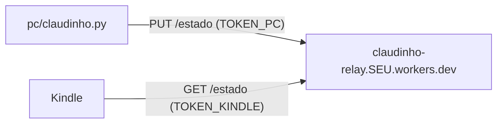

# Modo remoto (Kindle e PC em redes diferentes)

No modo remoto, o PC envia o estado para um pequeno relay na sua conta Cloudflare, e o Kindle lê de lá. Nenhum dos dois precisa abrir porta, e funciona com o Kindle em qualquer Wi-Fi (casa, trabalho, roteador do celular).



## Custo e limites

Tudo cabe no **plano gratuito** da Cloudflare. O relay guarda o estado num Durable Object com SQLite, que no plano gratuito permite 100 mil requisições e 100 mil gravações por dia.

| Quem | Quanto | Por dia (uso pesado) |
|---|---|---|
| Kindle lendo | 1 leitura a cada 60 s | ~1.440 |
| Kindle com o painel aberto | 1 a cada 30 s | ~2.880 |
| PC | quando o modo muda (no máximo a cada 3 s), detalhes a cada 15 s, e um sinal de vida a cada 5 min | até ~6.000 |

## Publicar (com o setup)

Precisa do [Node.js](https://nodejs.org) instalado e de uma conta Cloudflare (grátis).

```sh
python3 pc/setup.py modo
```

Escolha **2) Remoto** e aceite publicar com o wrangler. Ele:

1. roda `npx wrangler deploy` (na primeira vez, abre o navegador para você entrar na Cloudflare);
2. grava os segredos `TOKEN_PC` e `TOKEN_KINDLE` no Worker;
3. envia um estado de teste e lê de volta com o token do Kindle;
4. grava `pc/config.json` e o `config.lua` do plugin.

Copie de novo a pasta `kindle/claudinho.koplugin` para o Kindle (o `config.lua` mudou) e rode `python3 pc/claudinho.py`.

## Publicar à mão

```sh
cd relay
npx wrangler login
npx wrangler deploy
npx wrangler secret put TOKEN_PC
npx wrangler secret put TOKEN_KINDLE
```

Use dois textos aleatórios longos como tokens (o setup mostra sugestões). O deploy imprime a URL, algo como `https://claudinho-relay.SEU-USUARIO.workers.dev`. Depois:

```sh
python3 pc/setup.py --modo remoto --url https://claudinho-relay.SEU-USUARIO.workers.dev \
    --token-pc O_TOKEN_PC --token O_TOKEN_KINDLE --sem-hooks
```

## Como o Kindle sabe que o PC sumiu

- O relay responde sempre com `X-Claudinho-Idade`: quantos segundos faz que o PC mandou o estado, medido pelo relógio do próprio relay. Assim, um Kindle com a hora errada não se confunde.
- O PC manda um sinal de vida a cada 5 minutos mesmo sem mudança. Sem notícia há mais de 10 minutos, o Kindle mostra **"Sem sinal do PC"**.
- Ao fechar o agente com Ctrl+C, ele avisa o relay, e o Kindle mostra "PC desligado?" na próxima busca.

## O que sai do seu PC

O estado é um JSON pequeno, assim:

```json
{"v":1,"modo":"cozinhando","desde":1792715237,"ferramenta":"Edit",
 "descricao":"DashboardController.java","ativos":1,"projeto":"camaleao",
 "antes":["Read","Grep","Bash"],"sessao":{"pct":11,"zera":"zera às 15:00"},
 "semana":{"pct":19,"zera":"zera dom 21:00"},
 "tokens":{"hoje":2480000,"hora":420000,"media":1830000},"rev":"bcd87aea4697","agora":1792715244}
```

Ou seja: nomes de ferramentas, o nome do arquivo ou a descrição curta do comando em uso, o nome da pasta do projeto, os percentuais de uso e as contagens de tokens. **Nenhum código, prompt ou conteúdo de arquivo** sai do PC. O relay guarda só o último estado, na sua conta Cloudflare.

Se quiser esconder até os nomes de arquivos, use o modo local.

## Trocar os tokens

Apague `token` e `token_pc` de `pc/config.json` e rode `python3 pc/setup.py modo` de novo: ele gera tokens novos e grava os segredos. Depois copie o plugin para o Kindle outra vez.

## Remover o relay

```sh
cd relay && npx wrangler delete
```
